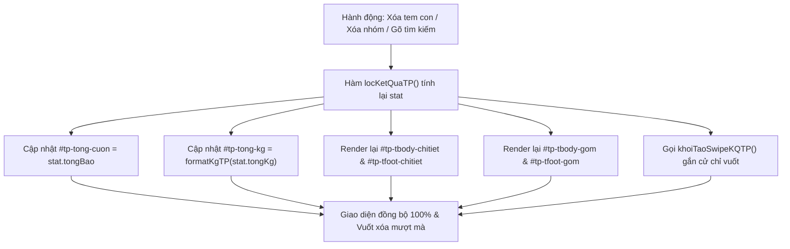

# 📋 Kế Hoạch Kỹ Thuật: Đồng Bộ Số Liệu & Kích Hoạt Vuốt Ngang Xóa Phân Hệ Thành Phẩm (TP) - Bản Chuẩn v8

> **Tôn chỉ thực hiện**:
> 1. **Đồng bộ số liệu 100%**: Ô tổng số bao (`#tp-tong-cuon`) và tổng khối lượng (`#tp-tong-kg`) trên đầu luôn khớp chính xác với số liệu thực tế của bảng và dòng `TỔNG` footer khi xóa tem con, xóa nhóm, hoặc tìm kiếm.
> 2. **Kích hoạt tính năng vuốt ngang xóa (Swipe-to-Delete)**: Hỗ trợ cử chỉ vuốt ngang nhóm QC trên cả Bảng Kết Quả và Live Log camera, hiển thị nút "Xóa" đỏ 76px với xác nhận an toàn.
> 3. **Bảo toàn tuyệt đối định dạng Xuất Excel**: Giữ nguyên vẹn 100% cấu trúc 2 cột hiện tại (`"Thời gian"` và `"Mã QR Gốc"`), không can thiệp hay thay đổi cột theo chỉ đạo của người dùng.
> 4. **Tinh chỉnh trải nghiệm**: Thông báo Empty State chuẩn ngữ cảnh và mở rộng vùng chạm nút xóa tem con `×` trên màn hình cảm ứng điện thoại.

---

## 1. Phân Tích Thực Tế & Nguyên Nhân Kỹ Thuật

### 1.1. Lỗi Lệch Số Liệu Giữa Khung Tóm Tắt & Bảng Kết Quả
* **Hiện tượng trong ảnh thực tế**:
  - Khung tóm tắt trên đầu: **Tổng Số Bao: 4**, **Tổng Khối Lượng: 225.6**.
  - Bảng Chi Tiết bên dưới: chỉ còn **1 bao** (56.4 kg), dòng footer báo **TỔNG: 1 | 56.4**.
* **Nguyên nhân gốc rễ**:
  - Khi mở màn hình kết quả, `hienKetQuaTP()` tính `stat` ban đầu (4 bao, 225.6 kg) và gán vào `#tp-tong-cuon` và `#tp-tong-kg`.
  - Khi người dùng xóa bớt 3 mã (bằng nút `×`), hàm `xoaMaTP()` xóa mã khỏi `phienTP` rồi gọi `locKetQuaTP()`.
  - Trong `locKetQuaTP()`, code chỉ tính lại `stat` mới (1 bao, 56.4 kg) để vẽ lại `#tp-tbody-chitiet`, `#tp-tfoot-chitiet`, `#tp-tbody-gom`, `#tp-tfoot-gom`, nhưng **hoàn toàn quên cập nhật lại `#tp-tong-cuon` và `#tp-tong-kg`**!
  - Kết quả là 2 ô tóm tắt trên đầu bị đóng băng ở số liệu cũ, gây lệch nghiêm trọng so với bảng.

### 1.2. Thiếu Tính Năng Vuốt Ngang Xóa (Swipe-to-Delete)
* **Hiện tượng**: Vuốt ngang hàng nhóm QC không trượt ra nút đỏ "Xóa" như BTP hay CX1.
* **Nguyên nhân kỹ thuật (3 thiếu sót phối hợp)**:
  1. Trong `tp.js` hàm `taoHtmlNhomTP()`: code chỉ sinh nút swipe khi `context === "log"`, còn ở bảng kết quả (`context === "kq"`) thì gán chuỗi rỗng `swipeActions = ""`.
  2. Trong `tp.js`: Chưa khởi tạo swipe listener cho container `#tp-tbody-chitiet`.
  3. Trong `scanner-core.js`: Bộ xử lý `khoiTaoSwipe` chỉ tìm selector:
     ```javascript
     const actionsEl = wrap ? wrap.querySelector(".kq-swipe-actions, .btp-swipe-actions") : null;
     ```
     và `e.target.closest(".kq-swipe-actions, .btp-swipe-actions")`.
     Vì `tp.js` đặt class `.tp-swipe-actions`, selector không khớp nên `actionsEl === null` $\rightarrow$ lệnh vuốt bị return ngay lập tức (`if (!actionsEl) return;`), làm tê liệt cử chỉ vuốt trên cả Live Log lẫn bảng kết quả.
  4. Trong `style.css`: `.tp-swipe-content` thiếu `touch-action: pan-y;` và `-webkit-user-select: none;` khiến cử chỉ vuốt ngang dễ bị trình duyệt chặn hoặc giật cuộn dọc.

---

## 2. Giải Pháp Kỹ Thuật Chi Tiết



### 2.1. Cập Nhật Đồng Bộ Ô Tổng Trên Đầu (`tp.js`)
Trong `locKetQuaTP()` của [tp.js](file:///C:/NTV/Code%20gốc/tp.js), sau khi tính `stat = tinhThongKePhienTP(list)`:
```javascript
// ── Đồng bộ Khung Tóm Tắt trên đầu với Bảng Kết Quả ──
const elTongBao = document.getElementById("tp-tong-cuon");
const elTongKg = document.getElementById("tp-tong-kg");
if (elTongBao) elTongBao.textContent = stat.tongBao;
if (elTongKg) elTongKg.textContent = formatKgTP(stat.tongKg);
```

### 2.2. Kích Hoạt Vuốt Ngang Xóa Nhóm QC
1. **Mở rộng selector trong [scanner-core.js](file:///C:/NTV/Code%20gốc/scanner-core.js)**:
   - Sửa dòng tìm `actionsEl`:
     ```javascript
     const actionsEl = wrap ? wrap.querySelector(".kq-swipe-actions, .btp-swipe-actions, .tp-swipe-actions") : null;
     ```
   - Sửa listener chặn click khi swipe:
     ```javascript
     if (!e.target.closest(".kq-swipe-actions, .btp-swipe-actions, .tp-swipe-actions")) {
       e.stopPropagation();
       e.preventDefault();
     }
     ```
2. **Sinh HTML Swipe Actions cho Bảng Kết Quả trong [tp.js](file:///C:/NTV/Code%20gốc/tp.js)**:
   - Trong `taoHtmlNhomTP(g, isFirst, context, coTuKhoa)`:
     ```javascript
     const swipeActions = `
       <div class="tp-swipe-actions kq-swipe-actions">
         <button type="button" class="tp-swipe-btn-del" onclick="xoaNhomTPByB64('${keyB64}', event)" title="Xóa nhóm QC">
           <i class="ti ti-trash"></i>
           <span>Xóa</span>
         </button>
       </div>`;
     ```
3. **Khởi tạo cử chỉ vuốt cho Bảng Kết Quả trong [tp.js](file:///C:/NTV/Code%20gốc/tp.js)**:
   - Định nghĩa hàm:
     ```javascript
     function khoiTaoSwipeKQTP() {
       if (window.ScannerCore && typeof window.ScannerCore.khoiTaoSwipe === "function") {
         window.ScannerCore.khoiTaoSwipe("tp-tbody-chitiet", ".tp-swipe-content", "__swipeKqInitTP");
       }
     }
     ```
   - Gọi `khoiTaoSwipeKQTP()` bên trong `locKetQuaTP()`.
4. **Cập nhật CSS trong [style.css](file:///C:/NTV/Code%20gốc/style.css)**:
   - Bổ sung `touch-action: pan-y; -webkit-user-select: none;` cho `.tp-swipe-content`.
   - Chuẩn hóa nút `.tp-swipe-btn-del`:
     ```css
     .tp-swipe-btn-del {
       width: 100%;
       height: 100%;
       border: none;
       background: transparent;
       color: #ffffff;
       font-size: 12px;
       font-weight: 700;
       display: flex;
       flex-direction: column;
       align-items: center;
       justify-content: center;
       gap: 2px;
       cursor: pointer;
       padding: 0;
     }
     ```

### 2.3. Hai Tinh Chỉnh Bổ Sung (Không Đụng Excel)
1. **Thông báo Empty State chuẩn ngữ cảnh trong `locKetQuaTP()`**:
   - Khi `stat.gomNhom.length === 0`:
     + Bảng Chi Tiết: `coTuKhoa ? "Không tìm thấy mã phù hợp" : "Chưa có mã quét nào trong phiên"`.
     + Bảng Tổng Hợp: `coTuKhoa ? "Không tìm thấy mã phù hợp" : "Không có dữ liệu tổng hợp"`.
2. **Tối ưu Touch Target nút `×` xóa tem con**:
   - Thêm `padding: 6px; margin: -6px; touch-action: manipulation;` cho `.tp-sub-del-btn` trong `style.css` giúp bấm nhạy và chính xác trên màn hình cảm ứng mà không xô lệch độ rộng 18px của cột lưới.

---

## 3. Ma Trận Kiểm Thử (Test Matrix)

| STT | Kịch bản kiểm thử | Hành vi kỳ vọng | Tiêu chí đạt |
| :---: | :--- | :--- | :---: |
| **1** | Mở màn kết quả phiên 4 bao (225.6 kg) | Ô trên: 4 bao, 225.6 kg. Footer: 1 bao 56.4 kg (nếu có 1 nhóm) hoặc 4 bao 225.6 kg | Đạt |
| **2** | Bấm nút `×` xóa 3 tem con (còn 1 tem 56.4 kg) | Ô trên cập nhật ngay về 1 bao, 56.4 kg, khớp 100% với Footer | Đạt |
| **3** | Xóa nốt tem cuối cùng (`phienTP = []`) | Ô trên: 0 bao, 0 kg; Footer: 0 bao, 0 kg; Bảng hiện "Chưa có mã quét nào trong phiên" | Đạt |
| **4** | Gõ từ khóa vào ô tìm kiếm | Ô trên và Footer cùng lọc theo kết quả tìm kiếm; xóa tìm kiếm $\rightarrow$ trở về tổng phiên | Đạt |
| **5** | Vuốt ngang sang trái hàng nhóm QC trên Bảng Kết Quả | Hàng trượt mượt sang trái 76px, lộ nút đỏ có icon thùng rác và chữ "Xóa" | Đạt |
| **6** | Bấm nút "Xóa" trên hàng swiped | Hiện modal: "Xóa toàn bộ N bao của nhóm này?"; xác nhận $\rightarrow$ nhóm bị xóa, ô trên và bảng cập nhật tức thì | Đạt |
| **7** | Chạm vào hàng đang swiped | Hàng trượt đóng lại về vị trí ban đầu (0px), không kích hoạt mở accordion | Đạt |
| **8** | Vuốt ngang trên Live Log camera | Trượt mượt sang trái 76px lộ nút Xóa (nhờ `scanner-core.js` đã hỗ trợ `.tp-swipe-actions`) | Đạt |
| **9** | Bấm nút `×` xóa tem con trên mobile | Diện tích cảm ứng 30px bấm cực nhạy, không bấm hụt | Đạt |
| **10** | Xuất Excel Thành Phẩm | File `.xlsx` xuất ra vẫn giữ đúng định dạng 2 cột: "Thời gian" và "Mã QR Gốc" | Đạt |

---

## 4. Danh Sách Tệp Thay Đổi

1. [tp.js](file:///C:/NTV/Code%20gốc/tp.js): Cập nhật ô tổng trong `locKetQuaTP()`, mở `swipeActions` cho `ctx === "kq"`, thêm `khoiTaoSwipeKQTP()`, sửa empty state.
2. [scanner-core.js](file:///C:/NTV/Code%20gốc/scanner-core.js): Thêm `.tp-swipe-actions` vào selector của `khoiTaoSwipe`.
3. [style.css](file:///C:/NTV/Code%20gốc/style.css): Thêm `touch-action: pan-y;` cho `.tp-swipe-content`, định kiểu cột cho `.tp-swipe-btn-del`, tăng touch target cho `.tp-sub-del-btn`.
4. [sw.js](file:///C:/NTV/Code%20gốc/sw.js) & [android/app/build.gradle](file:///C:/NTV/Code%20gốc/android/app/build.gradle): Nâng cache lên `kho-cache-v167`, `versionCode 145`, `versionName "2.44"`.
5. [build-web.js](file:///C:/NTV/Code%20gốc/build-web.js): Đồng bộ web assets sang `www/` và `android/app/src/main/assets/public/`.
